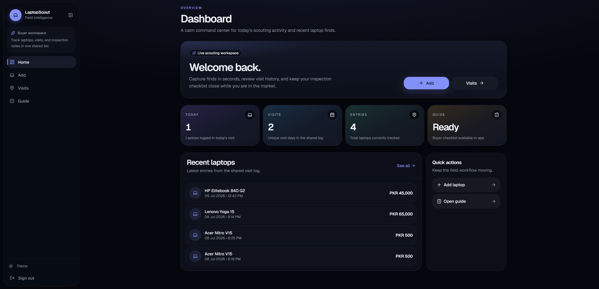
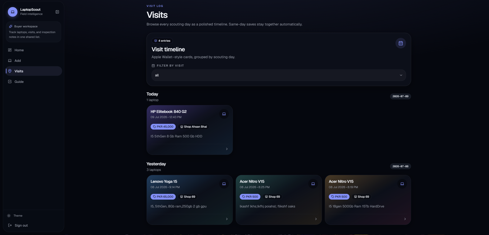
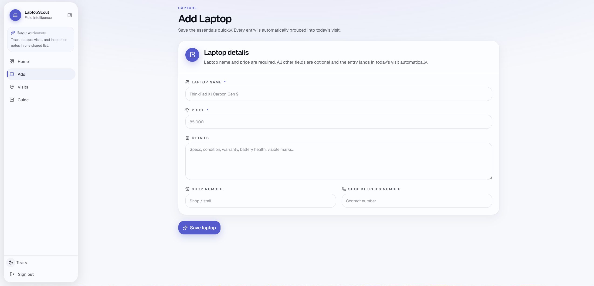

# 💻 TheLaptopScout

<p align="center">
  
</p>

<p align="center">
  <strong>A modern, mobile-first companion for buying and scouting laptops.</strong>
</p>

<p align="center">
  📋 Checklist &nbsp;•&nbsp; 💻 Laptop Tracking &nbsp;•&nbsp; 📅 Visit History &nbsp;•&nbsp; 🌗 Dark/Light Mode
</p>

---

## 🧠 The Story

Buying a used laptop can be exhausting.

You're checking the CPU, RAM, storage, battery, display, GPU, ports, temperatures, PowerShell commands, benchmarks, price...

Eventually, **dimaag ki dahi ho jati hai.** 😂

A couple of years ago, during one of those *"I should probably be sleeping right now"* nights, boredom and insomnia teamed up and I built **[LaptopScout](https://github.com/mrhassansaif/LaptopScout)** — a small React + Vite project to keep useful laptop-buying checks and information in one place.

Fast-forward to today: I finally had the time and motivation to give that old project the glow-up it deserved.

**TheLaptopScout** is a complete revamp of the original idea — rebuilt with a modern stack, better architecture, a mobile-first UI, automatic visit tracking, Firestore, and a much more polished design.

Basically:

> **3 AM boredom → random project → actually useful → full rebuild.**

---

## ✨ What It Does

TheLaptopScout keeps the entire laptop-hunting process in one place.

* 📋 **Laptop Buying Checklist** — Check hardware, software, battery, display, ports, benchmarks and more.
* 💻 **Add Laptop** — Save laptop name, price, details, shop number and shopkeeper information.
* 📅 **Automatic Visits** — Entries are automatically grouped by the date they were added.
* 🗂️ **Visit History** — Browse previous visits and everything recorded during them.
* 🖼️ **Beautiful Cards** — Review saved laptops without digging through giant tables.
* 🌗 **Dark / Light Mode** — Pick your preferred theme.
* 📱 **Mobile First** — Designed for actually using it while standing inside a laptop shop.

---

## 🖥️ Preview

<p align="center">
  
  
</p>

---

## 🛠️ Tech Stack

* **Next.js**
* **TypeScript**
* **Tailwind CSS**
* **shadcn/ui**
* **Firebase Authentication**
* **Firestore**

---

## 🚀 Open Source

**TheLaptopScout is now open source. 🎉**

Want to run your own version?

Clone or fork the repository, connect your own Firebase project, add your own `.env.local`, and you're good to go.

You can freely:

* 🎨 Redesign the UI
* ✨ Add features
* 📋 Modify the checklist
* 🗃️ Change the data structure
* 🧠 Experiment with the logic
* 🚀 Deploy your own version
* 💡 Suggest improvements

If you build something cool with it, I'd love to see it.

---

## 🔮 What's Next?

The next feature I'm thinking about is **📸 Image Uploads for Laptop Entries**.

Imagine saving:

```text
Acer Nitro V15
PKR 135,000

📸 Front
📸 Keyboard
📸 Display
📸 Damage / Condition
📸 Serial Sticker
```

That way, when you revisit an old shop visit months later, you don't just remember the specs and price — **you can actually see the laptop you checked.**

More improvements will probably happen whenever I get bored again. 😂

---

## 🤝 Contributing

Found a bug? Have an idea? Think the UI needs more sauce?

Feel free to open an **Issue** or submit a **Pull Request**.

Suggestions, improvements, redesigns, and completely random ideas are welcome.

---

## ⭐ One Last Thing

TheLaptopScout started because I couldn't sleep and had nothing better to do.

Now it's a proper open-source project.

**Not bad for a late-night idea. 😎**

<p align="center">
  Built with boredom, insomnia, caffeine, and questionable late-night decisions.
  <br><br>
  <strong>Happy laptop hunting. 💻</strong>
</p>
